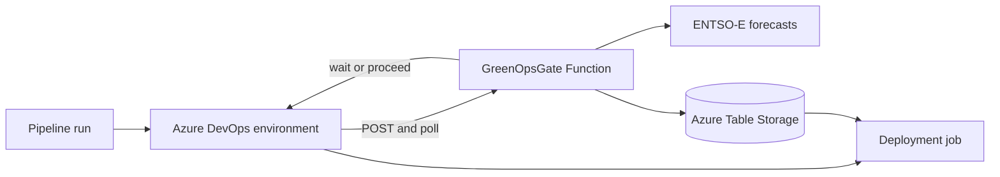

# Sustainability Gate for Azure DevOps

This repository is a working example of an Azure DevOps deployment gate that
can delay a deployment until a better time or Azure region is available. The
gate is an HTTP-triggered PowerShell Azure Function. An Azure DevOps
Environment invokes it before a deployment job starts.

The Function uses ENTSO-E day-ahead generation forecasts to compare the allowed
regions and deployment times.

> [!IMPORTANT]
> This project compares `total generation - wind and solar generation`, in MW.
> That residual-generation forecast is a scheduling proxy. It is not measured
> carbon intensity and it is not a complete renewable/non-renewable split.

## Architecture



The first Function call calculates and stores one decision for the combination
of Azure DevOps project, build, and deployment category. Later polls reuse that
decision. This prevents a deployment from continuously chasing a moving
forecast.

## Repository layout

| Path | Purpose |
| --- | --- |
| `function/GreenOpsGate/run.ps1` | Six-stage HTTP Function workflow |
| `function/GreenOpsGate/GreenOpsGate.ps1` | Validation, forecast, storage, and decision functions |
| `function/data/azure-region-eic-mapping.json` | Azure region to ENTSO-E bidding-zone mapping |
| `pipelines/deploy-function.yml` | ZIP-deploys the gate Function |
| `azure-pipelines.yml` | Minimal deployment pipeline protected by the gate |
| `scripts/Show-GreenOpsDecision.ps1` | Reads the approved decision after the check |

## Prerequisites

- An Azure subscription and permission to create resources and role assignments.
- An Azure DevOps project with access to this GitHub repository.
- An Azure Resource Manager service connection. Workload identity federation is
  recommended instead of a client secret.
- Azure CLI for the setup commands below.
- PowerShell 7 with the `Az.Accounts` module, Azure Functions Core Tools 4, and
  Azurite only when running the Function locally.
- An ENTSO-E Transparency Platform API token.

## 1. Create the Azure resources

The following PowerShell-friendly Azure CLI example creates a Flex Consumption
Function App, a storage account, and the decision table. Storage and Function
App names must be globally unique and use lowercase letters and numbers.

```powershell
$SubscriptionId = '<subscription-id>'
$ResourceGroup = 'rg-greenops-gate'
$Location = 'westeurope'
$StorageAccountName = '<globally-unique-storage-name>'
$FunctionAppName = '<globally-unique-function-name>'
$TableName = 'GreenOpsDecisions'

az login
az account set --subscription $SubscriptionId

az group create `
  --name $ResourceGroup `
  --location $Location

az storage account create `
  --name $StorageAccountName `
  --resource-group $ResourceGroup `
  --location $Location `
  --sku Standard_LRS `
  --kind StorageV2 `
  --allow-blob-public-access false

# The connection string is held only in this PowerShell process and is not
# written to the repository.
$StorageConnectionString = az storage account show-connection-string `
  --name $StorageAccountName `
  --resource-group $ResourceGroup `
  --query connectionString `
  --output tsv
az storage table create `
  --name $TableName `
  --connection-string $StorageConnectionString
$StorageConnectionString = $null

az functionapp create `
  --name $FunctionAppName `
  --resource-group $ResourceGroup `
  --storage-account $StorageAccountName `
  --flexconsumption-location $Location `
  --runtime powershell `
  --runtime-version 7.4 `
  --functions-version 4
```

Enable the Function's system-assigned managed identity and give it data-plane
permission to create and update decision entities:

```powershell
$FunctionPrincipalId = az functionapp identity assign `
  --name $FunctionAppName `
  --resource-group $ResourceGroup `
  --query principalId `
  --output tsv
$StorageAccountId = az storage account show `
  --name $StorageAccountName `
  --resource-group $ResourceGroup `
  --query id `
  --output tsv

az role assignment create `
  --assignee-object-id $FunctionPrincipalId `
  --assignee-principal-type ServicePrincipal `
  --role 'Storage Table Data Contributor' `
  --scope $StorageAccountId

az functionapp config appsettings set `
  --name $FunctionAppName `
  --resource-group $ResourceGroup `
  --settings `
    GREENOPS_STORAGE_ACCOUNT_NAME=$StorageAccountName `
    GREENOPS_TABLE_NAME=$TableName
```

Role assignments can take several minutes to become effective. The Function
uses its managed identity and does not need a storage key.

Request an API token from the ENTSO-E Transparency Platform and add it as the
`ENTSOE_TOKEN` Function App setting before invoking the gate. Treat it as a
secret: use the Azure portal configuration page or a Key Vault reference, and
never commit it.

## 2. Deploy the Function

In Azure DevOps, create a pipeline from this GitHub repository and select
`pipelines/deploy-function.yml` as the existing YAML file. When you run it,
provide:

| Parameter | Required value |
| --- | --- |
| `azureServiceConnection` | Azure Resource Manager service connection name |
| `resourceGroupName` | Resource group created above |
| `functionAppName` | Function App created above |

The service connection needs permission to deploy to the Function App, such as
`Contributor` scoped to that Function App or its resource group. The pipeline
creates a ZIP whose root contains `host.json` and publishes it. Azure Functions
managed dependencies install the pinned major version of `Az.Accounts` from
`function/requirements.psd1`.

After deployment, retrieve the function key. Treat the returned value as a
secret and do not add it to YAML or a variable committed to Git.

```powershell
az functionapp function keys list `
  --name $FunctionAppName `
  --resource-group $ResourceGroup `
  --function-name GreenOpsGate `
  --query default `
  --output tsv
```

The endpoint is:

```text
https://<function-app-name>.azurewebsites.net/api/GreenOpsGate
```

## 3. Configure the Azure DevOps gate

Checks are owned by protected resources in Azure DevOps and are deliberately
not defined in pipeline YAML. This prevents someone who can edit a pipeline
from removing its gate.

1. Open **Pipelines > Environments** in the Azure DevOps project.
2. Create an environment named `greenops`.
3. Open its **Approvals and checks** tab and add **Invoke Azure Function**.
4. Set the Azure Function URL to the endpoint above and enter the Function key.
5. Select `POST` and set the header to `{"Content-Type":"application/json"}`.
6. Use this request body:

```json
{
  "buildId": "$(Build.BuildId)",
  "projectId": "$(System.TeamProjectId)",
  "repositoryId": "$(Build.Repository.ID)",
  "category": "$(DeploymentCategory)",
  "preferredLocation": "$(PreferredLocation)",
  "allowedLocations": "$(AllowedLocations)",
  "allowedWaitMinutes": "$(AllowedWaitMinutes)"
}
```

1. Under **Advanced**, choose completion event `ApiResponse`.
2. Set success criteria to `eq(root['status'], 'proceed')`.
3. Set **Time between evaluations** to 2 minutes and **Timeout** to 12 minutes.

The timeout leaves a polling margin after the sample's largest wait of 10
minutes. Its timeout/evaluation ratio is 6; Azure DevOps currently recommends a
ratio of at most 10 for synchronous checks. If you increase
`AllowedWaitMinutes`, adjust both settings while keeping that ratio at 10 or
less. The Function returns on every call; Azure DevOps owns the polling interval.

## 4. Configure the consumer pipeline

The root `azure-pipelines.yml` is a small application-pipeline example. Before
using it, replace these values in its `variables` block:

| Variable | Value |
| --- | --- |
| `AzureServiceConnection` | Service connection used by the application deployment |
| `GreenOpsStorageAccountName` | Storage account created above |
| `GreenOpsTableName` | Decision table, normally `GreenOpsDecisions` |

Grant the service principal behind this service connection **Storage Table Data
Reader** on the storage account. Azure subscription `Reader` is not enough;
Table Storage access is a separate data-plane permission. The service connection
also needs whatever permissions your real deployment requires.

Create a second Azure DevOps pipeline from `/azure-pipelines.yml`. It is manual
by default and exposes a `category` parameter. It contains only a deployment
stage. That stage references the `greenops` environment, which causes Azure
DevOps to evaluate the Function check before any deployment step runs.

After approval, `scripts/Show-GreenOpsDecision.ps1` reads the approved entity,
prints an audit summary, and creates the pipeline variable
`$(SelectedLocation)`. Replace the **Application deployment placeholder** step
with your deployment commands and use that variable when the workload supports
regional deployment.

The category policy is intentionally visible in YAML:

| Category | Default behavior |
| --- | --- |
| `hotfix` | No wait; choose the best allowed region now |
| `test` | Search the next minute |
| `production` | Search the next 10 minutes |

Change the regions and wait limits to fit your application. Keep the
`category`, preferred region, allowed regions, and wait limit stable for one
build: the Function rejects a poll that conflicts with its stored decision.

## Run locally

To run the host, start Azurite, copy the example settings, sign in to Azure so
`Get-AzAccessToken` can obtain a storage token, and start Functions Core Tools:

```powershell
Copy-Item ./function/local.settings.example.json ./function/local.settings.json
Install-Module Az.Accounts -Scope CurrentUser
Connect-AzAccount
Set-Location ./function
func start
```

Set `GREENOPS_STORAGE_ACCOUNT_NAME`, `GREENOPS_TABLE_NAME`, and `ENTSOE_TOKEN`
in the local file. Your signed-in identity needs **Storage Table Data
Contributor**. The `AzureWebJobsStorage` example uses Azurite for the Functions
host, while gate decisions are written to the configured Azure table.

## HTTP contract

Send the JSON body shown in **Configure the Azure DevOps gate** as a `POST`
request. Category must be `hotfix`, `test`, or `production`; locations are
case-insensitive and must be present in
`function/data/azure-region-eic-mapping.json`.

The response status is:

- `wait` before `notBeforeUtc`;
- `proceed` at or after `notBeforeUtc`;
- `error` if validation fails, a dependency fails, or a stored decision expires.

The Function returns a compact response:

```json
{
  "status": "wait",
  "decisionId": "project-build-category",
  "selectedLocation": "northeurope",
  "calculatedAtUtc": "2026-09-22T11:34:00Z",
  "notBeforeUtc": "2026-09-22T11:35:00Z",
  "approvedAtUtc": null,
  "reason": "Selected northeurope using the lowest forecast ResidualGenerationForecast."
}
```

Every decision also stores its inputs, selected region, data source, metric,
timestamps, evaluation count, and approval time in Azure Table Storage.

## Make it your own

- Edit `azure-pipelines.yml` to define your categories, regions, and wait limits.
- Extend `function/data/azure-region-eic-mapping.json` when adding Azure regions.
- Replace `Get-RegionForecast` when using another forecast or carbon-intensity
  provider. Keep its returned candidate shape so the decision logic stays intact.
- Replace the deployment placeholder with your application deployment.
- Add retention or lifecycle handling for old decision entities.
- Add Application Insights alerts and network restrictions before production use.
- Use a separate Function key per consuming team when independent rotation and
  revocation are important.

## Security notes

- No secrets belong in this repository or in pipeline YAML.
- The Function identity needs **Storage Table Data Contributor**, not account keys.
- Consumer pipelines need only **Storage Table Data Reader** for gate decisions.
- Keep Function authentication at `function`; store the key in the protected
  Environment check configuration.
- Scope Azure roles to the smallest practical resource.
- Review the Function and forecast-provider limits before making this a mandatory
  production control.

This project is licensed under the MIT License. See `LICENSE`.
